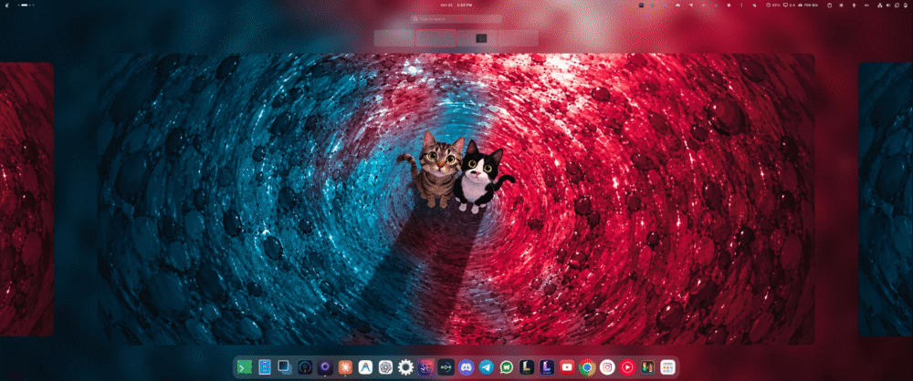
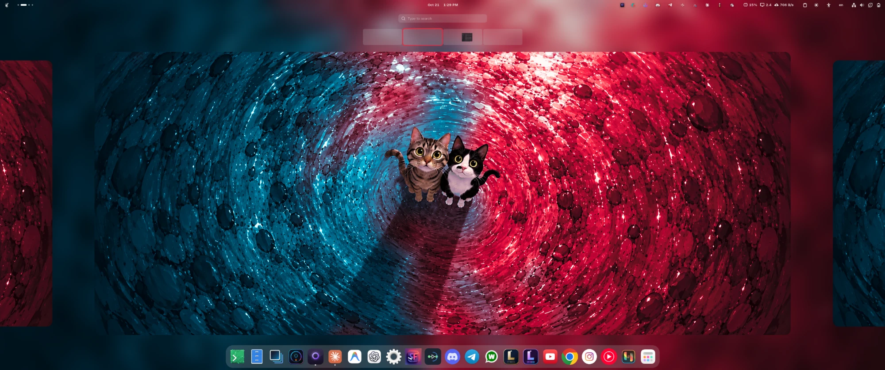
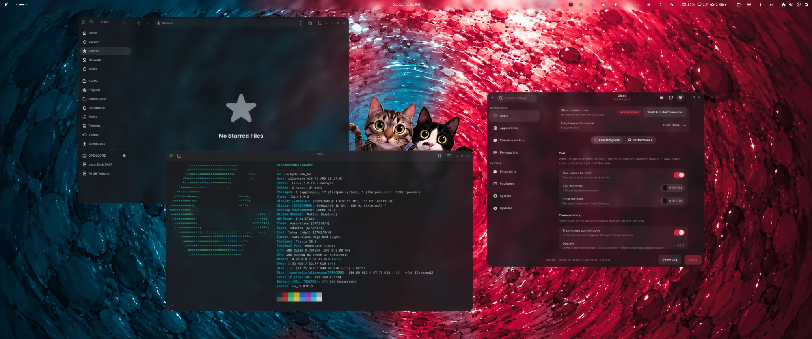
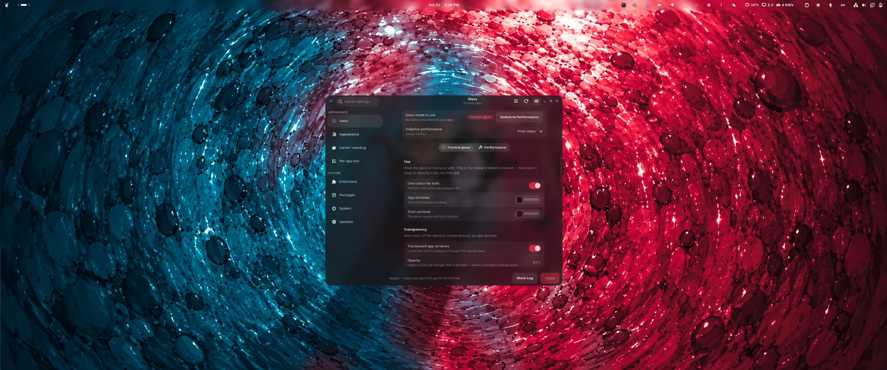
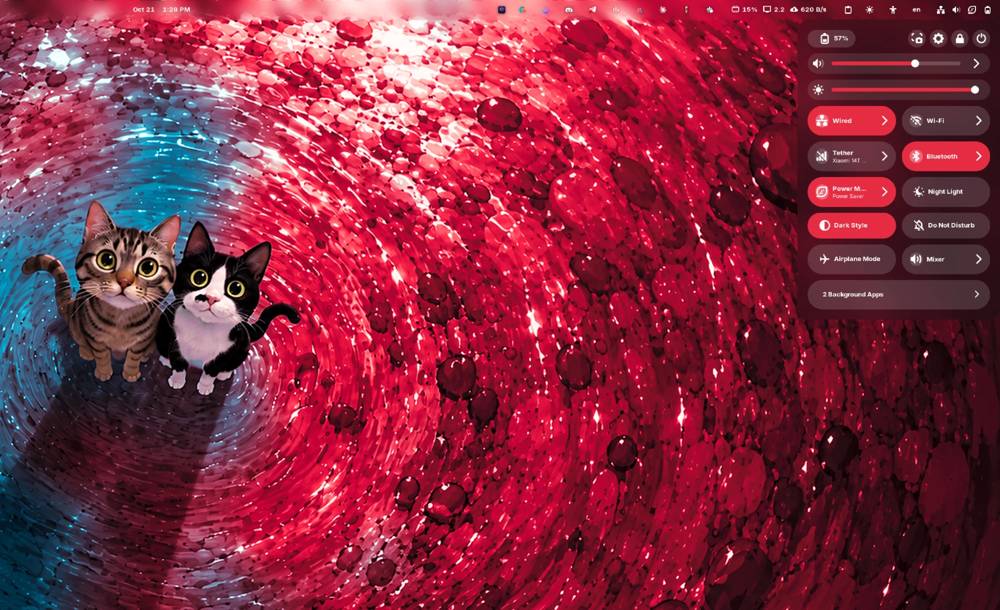
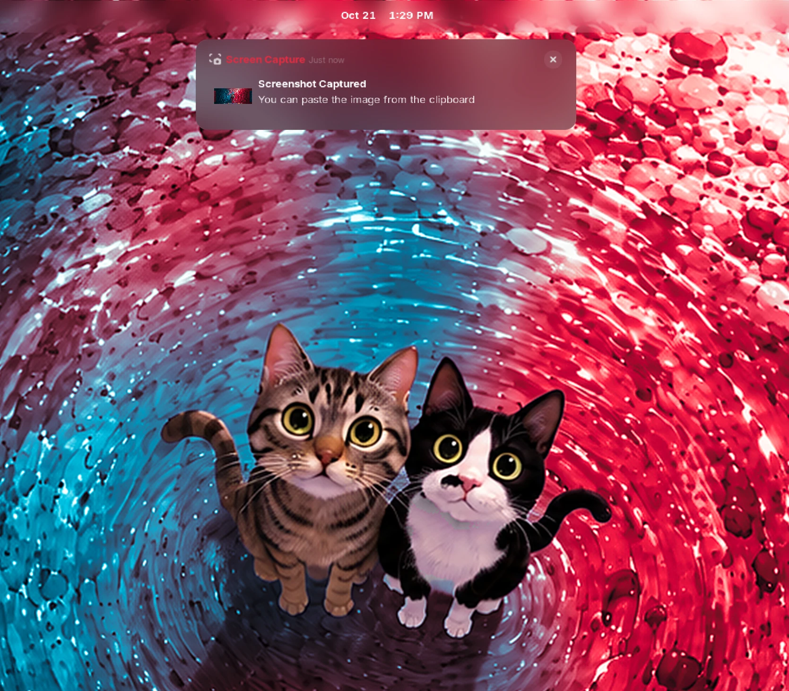
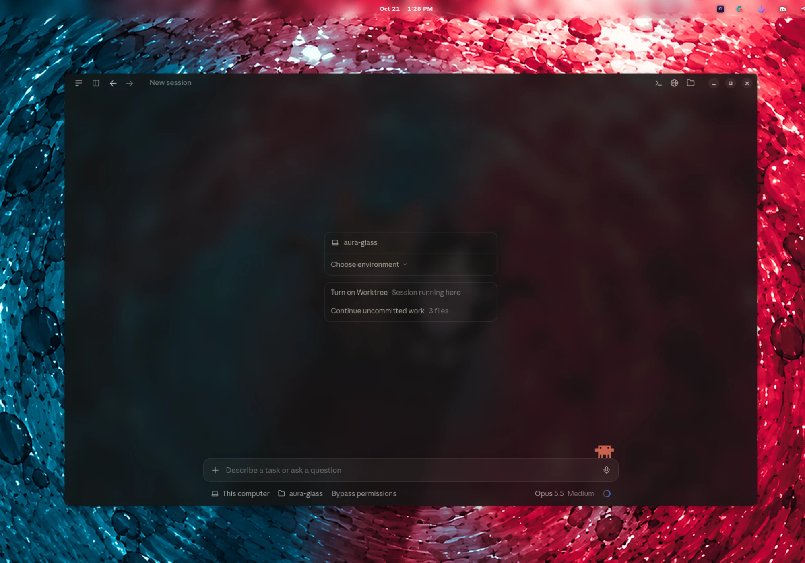
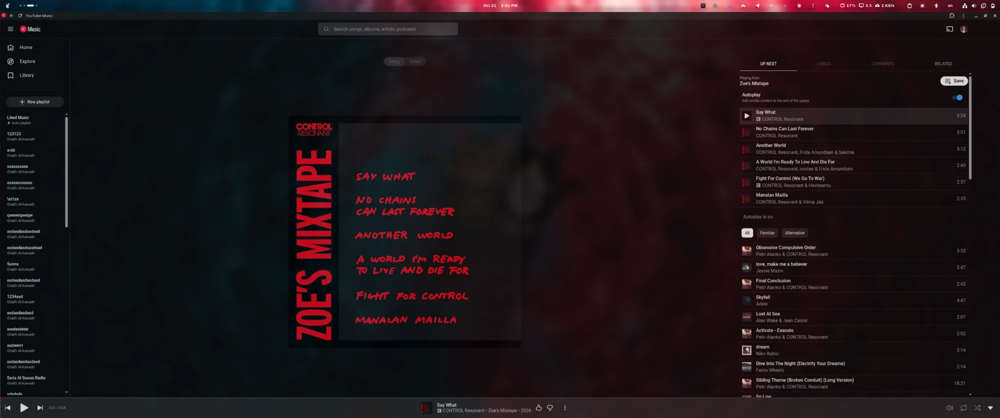

#  Aura Glass

[](https://github.com/DevWebeloper/aura-glass/releases/latest)
[](https://github.com/DevWebeloper/aura-glass/graphs/traffic)
[](https://github.com/DevWebeloper/aura-glass/stargazers)
[](LICENSE)

> **A frosted-glass desktop for GNOME Shell 48–51.**
> Real background blur behind the panel, menus, Quick Settings, notifications,
> dialogs and app windows, one consistent shape language across the shell, GTK4
> and GTK3, and a settings app to retune it all. Everything installs under your
> home directory and comes back out with `./uninstall.sh`.

<p align="center">
  
</p>

<p align="center">
  <a href="screenshots/overview.webp"></a>
  <a href="screenshots/desktop.webp"></a>
  <a href="screenshots/settings-app.webp"></a>
  <br>
  <a href="screenshots/quick-settings.webp"></a>
  <a href="screenshots/notification.webp"></a>
  <a href="screenshots/app-window.webp"></a>
  <a href="screenshots/youtube-music.webp"></a>
</p>

<p align="center"><sub>Click any screenshot for full size.</sub></p>

---

## What it is

Aura Glass is not a single theme file. It assembles a desktop from pinned
upstream pieces and then ties them together so they agree with each other:

| Piece | Where it comes from | What Aura Glass does to it |
|---|---|---|
| Shell + GTK theme | [GNOME-macOS-Tahoe](https://github.com/kayozxo/GNOME-macOS-Tahoe), pinned | installs it as `Aura-Glass`, flattens its shadows/gradients, swaps its hard-coded blues for your GNOME accent, splices in its own stylesheets |
| Blur | [Blur My Shell](https://github.com/aunetx/blur-my-shell) v73, built from a pinned commit | three patches (overview, sub-windows, separate notification blur) plus a tuned preset |
| Volume / brightness OSD | [Custom OSD](https://github.com/neuromorph/custom-osd), pinned and patched for GNOME 50/51 | a compact pill that sits on the blur |
| Aura Glass Helper | first-party extension in `extensions/` | "Blur This App" in the window menu, the adaptive-performance menu in the top bar, a D-Bus bridge for the settings app |
| Icons, pointers, fonts | Colloid / Reversal / Hatter icons; Adwaita / AOSP / MacTahoe / Moga pointers; Inter / MiSans / SF Pro | optional, picked in the wizard, accent-matched where the pack supports it |
| Settings app | `gui/` (GTK4 + libadwaita) | retunes everything without re-running the installer by hand |

## Quick start

```bash
git clone https://github.com/DevWebeloper/aura-glass.git
cd aura-glass
./install.sh
```

With no options in a terminal, `install.sh` opens a setup wizard (a GTK window
when one can be shown, the same questions in the terminal otherwise). It asks
for:

- **Accent colour.** One of GNOME's nine accents. The shell and GTK apps follow it live.
- **Blur.** Behind popups and menus, and behind app windows: all apps (the default), GTK/GNOME apps only, or none.
- **Window transparency.** 90 % (default), 82 % or 95 %.
- **Icons, pointer, pointer size, interface font.**
- **Extensions.** The wizard offers Full (all 8) or Minimal. `--recommended` (6 curated) and `--extensions LIST` pick a smaller set from the command line.
- **Login screen (GDM).** Optional. Themed and blurred, with live wallpaper sync. This needs `sudo`.

Non-interactive: `./install.sh --full -y`.

Every install also adds the wallpapers in [wallpapers/](wallpapers/) to GNOME's
own picker: **Settings › Appearance › Background**. They are offered, never
set. The files live in `~/.local/share/backgrounds/aura-glass/`.

**Then log out and back in.** Extensions can't be loaded into a running Wayland
session. The settings app opens itself once on your next login.

## Glass modes

| Mode | What you get |
|---|---|
| **Frosted** (default) | Blur behind the panel, menus, Quick Settings, notifications, dialogs and app windows, plus translucent surfaces tuned for it. |
| **Performance** | No blur shaders at all, so no blur GPU cost. Keeps the shapes, radii, accent and tints, with opaque or adjustable-opacity surfaces. |

Each mode remembers its own tint and transparency. Switch between them in
**Aura Glass Settings → Glass**, or run `./install.sh --settings-only --glass-mode performance -y`.

Frosted has a **Liquid** style for the top bar and the dock: their edges bend
what's behind them like a lens and catch a light rim. Both surfaces are then
static blur, computed once per wallpaper, so it costs no GPU while you work. The
dock then blurs the wallpaper instead of the windows passing behind it. Pick it
in **Glass → Glass style**, or run `./install.sh --settings-only --glass-style liquid -y`.
**Liquid behind app windows** (`--liquid-windows`) puts it behind Files and every
other blurred window too. Those then blur the wallpaper, not the window under them.

**Adaptive performance** sits on top of Frosted. A top-bar menu offers
**Auto / Full Glass / Performance**. In *Auto*, blur is dropped temporarily
while you're on battery, while the GPU is busy (≥ 80 % for ~6 s), or while a game
you picked is focused and fullscreen. It comes back when the trigger clears.
Your saved settings are never changed by this.

## Aura Glass Settings

Open **Aura Glass** from the app grid, or run `aura-glass-settings`.

- **Glass.** Mode, tints, transparency, blur strength, popup and window blur brightness, notification ground.
- **Appearance.** Accent, icons, pointer and its size, font, titlebar buttons and their style.
- **Corner rounding.** Seven presets or eight per-surface values. The blur behind always matches the corner painted on top.
- **Per-app blur.** A switch per app, the windows open right now, wildcard patterns, and the games that trigger Performance.
- **Extensions, Packages, System, Updates, Uninstall.**

Changes can be previewed live and are applied with one button.

## Handy commands

```bash
aura-glass-apply                     # re-splice the CSS after a theme/upstream update (offline, instant)
./install.sh --settings-only -y      # re-apply settings without re-downloading anything
./install.sh --dry-run               # show what a run would do, change nothing
./install.sh --help                  # every option
aura-glass-ext list                  # the extension catalogue
aura-glass-update-check              # is there a newer release?
./uninstall.sh                       # put everything back (see --help for scopes)
```

`~/.local/bin` must be on your `PATH`. For fish: `fish_add_path ~/.local/bin`.

## Requirements and support

- GNOME Shell **48, 49, 50 or 51**. Wayland is strongly preferred, since Blur My Shell is far less reliable on X11.
- `bash`, `python3`, `git`, `curl`, plus whatever the installer offers to install for your distro.
- The settings app and setup window also need PyGObject, libadwaita and pycairo (on Debian/Ubuntu that's `python3-gi python3-gi-cairo gir1.2-adw-1`).

| Family | Status |
|---|---|
| Arch / CachyOS / EndeavourOS | the tested path. `./install.sh`. An AUR recipe lives in [packaging/aur](packaging/aur/) |
| Fedora, Debian / Ubuntu, openSUSE | dependency mappings exist and the installer runs, but preflight reports them as untested |

Nothing outside `$HOME` is touched except three opt-in steps: the dependency
install, the `gnome-rounded-blur` fallback build, and the GDM login screen.

## Troubleshooting

- **Looks half-applied after an update?** Run `aura-glass-apply`, then log out and back in.
- **GTK apps didn't change?** Restart them. The shell reloads itself.
- **Reporting a bug?** Include `gnome-shell --version`, your session type, your distro, the output of `./install.sh --dry-run`, and `ls ~/.config/aura-glass`.

## Documentation

- [docs/README.md](docs/README.md) is the contributor documentation index: architecture, maps, configuration, testing.
- [CONTRIBUTING.md](CONTRIBUTING.md) covers the ground rules for a pull request.

## License

MIT for the scripts, stylesheets, patches and tooling in this repository (see
[LICENSE](LICENSE)). Upstream themes, extensions, icon/pointer packs and fonts
keep their own licences. SF Pro is Apple's and is fetched from a third-party
mirror only if you choose it.
